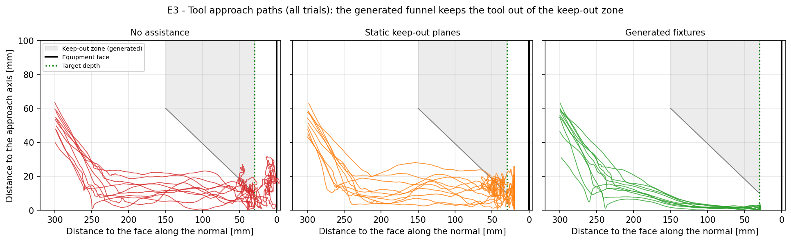
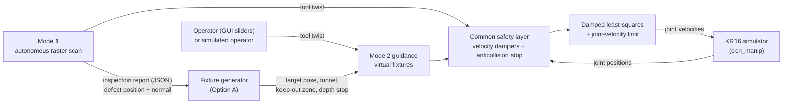
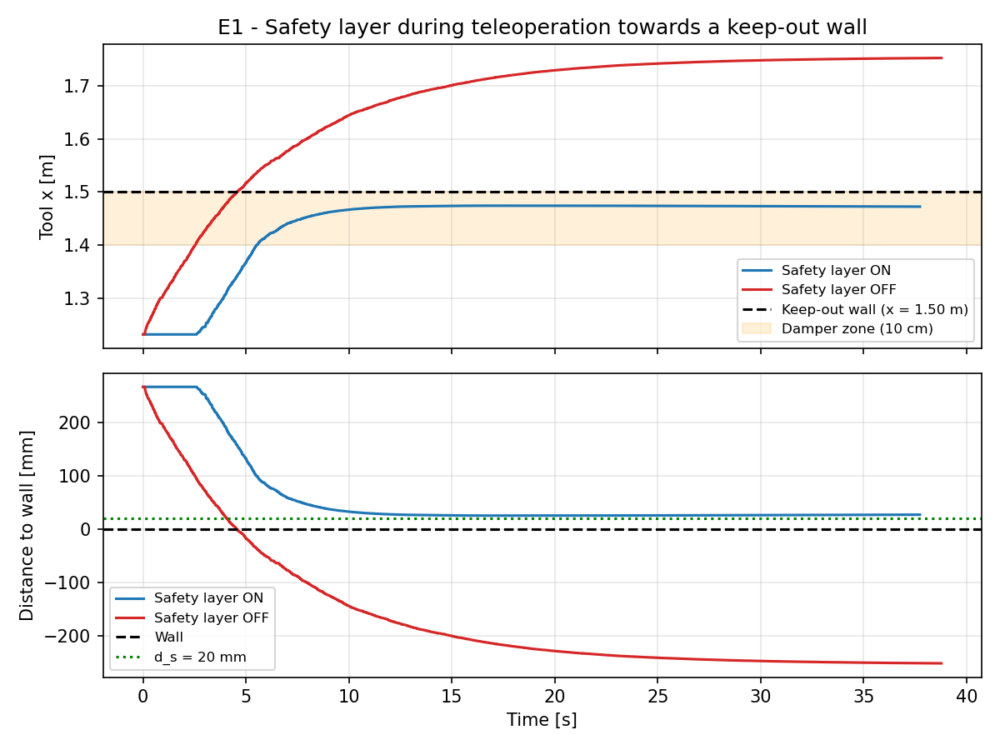
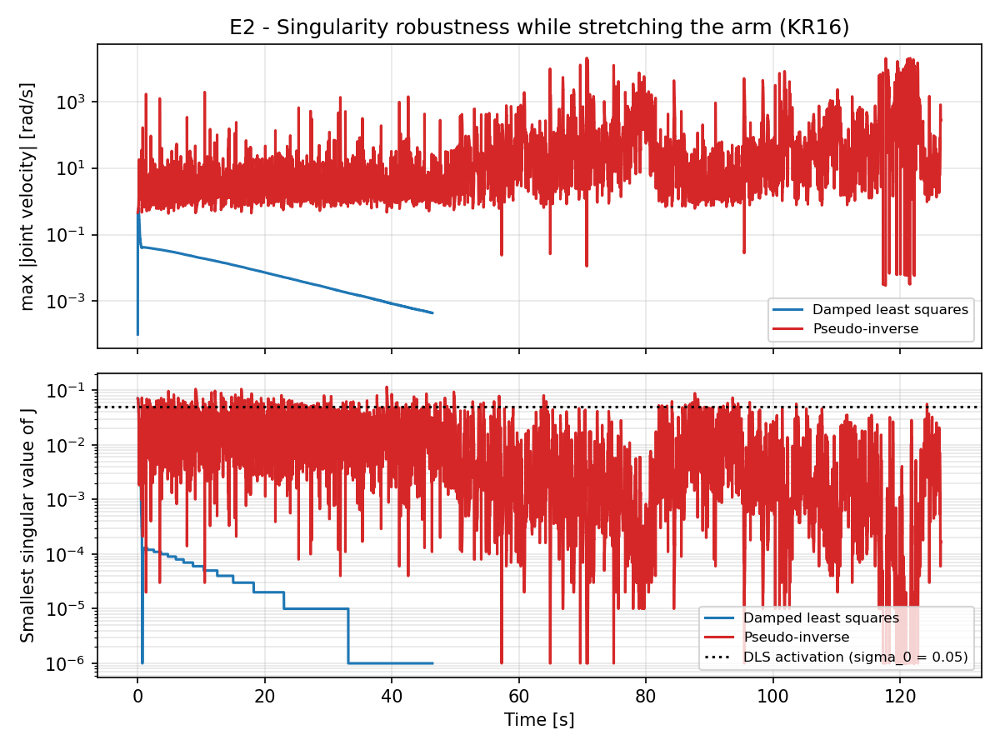
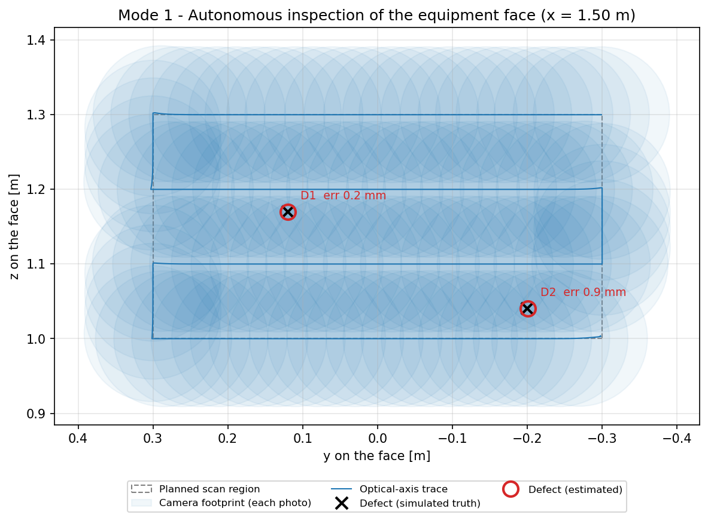
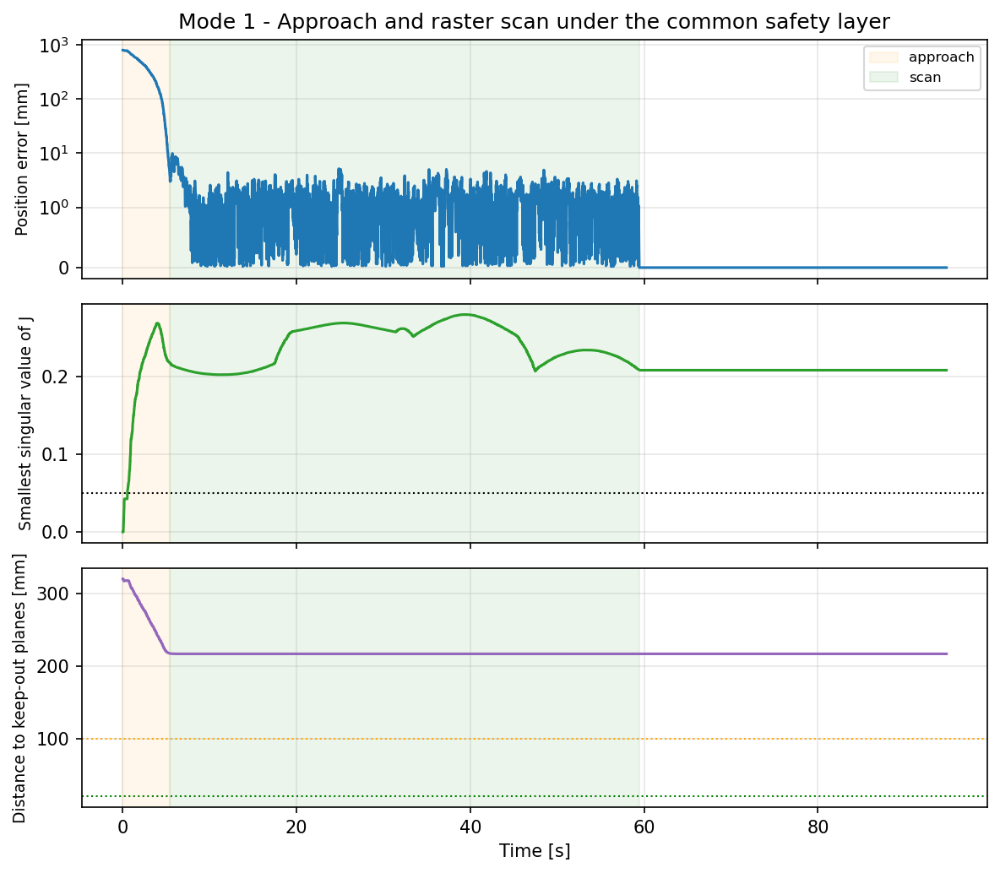
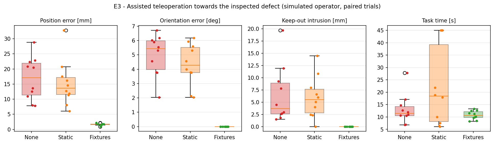

# Inspection-informed shared control for a KUKA KR16

**An autonomous inspection scan that automatically generates the virtual fixtures for the teleoperated repair, with one safety layer protecting both phases.** ROS 2 / C++ on the `ecn_manip` KUKA KR16 simulator.

In simulated repair trials, operators guided by the generated fixtures reached the defect with a **1.7 mm** error and **no keep-out intrusion in 10 of 10 trials**. Without them, the error was **15 to 17 mm**, and 9 or 10 of 10 trials entered the keep-out zone.



> Student research project, MSc Control and Robotics (CORO-IMARO), École Centrale de Nantes, course *Modelling of Manipulators*, 2026. The scenario is inspired by published CERN robotics work (see [Context](#context)). This project is **not affiliated with or endorsed by CERN**.

## Contents

- [Context](#context)
- [What it does](#what-it-does)
- [Demo videos](#demo-videos)
- [Operator keyboard (virtual joystick)](#operator-keyboard-virtual-joystick)
- [Results](#results)
- [Method](#method)
- [Build and run](#build-and-run)
- [Human trials](#human-trials-v07)
- [Reproduce the figures](#reproduce-the-figures)
- [Repository layout](#repository-layout)
- [Related work](#related-work)
- [Limitations](#limitations)
- [Credits and references](#credits-and-references)

## Context

CERN uses robots to inspect and repair equipment in radioactive areas: more than 20 robots and more than 1,000 robotic operations over 8 years, as of 2023 [[2]](#credits-and-references). Two phases matter here:

- **Autonomous inspection**, for example the ARIS system that scans RF cavities at short distance [[2]](#credits-and-references).
- **Teleoperated intervention**, where an operator drives a robot remotely to repair or handle equipment [[1]](#credits-and-references).

CERN's own presentations name the needs this project addresses: moving "from standard teleoperation to shared controls", anticollision and virtual fixtures, and less dependence on highly trained operators [[1]](#credits-and-references), [[2]](#credits-and-references). This project connects the two phases. **The inspection result becomes the operator's guidance.**

## What it does



1. **Mode 1, autonomous inspection.** The tool carries a simulated camera. It scans the equipment face in a serpentine raster at a fixed stand-off distance, detects hidden defects and writes an inspection report.
2. **Fixture generation (the contribution).** From the report, it builds a fixture around the defect:
   - a target tool pose;
   - an approach funnel;
   - a keep-out zone around it;
   - a virtual depth stop;
   - guidance: sideways motion is damped, the tool is pulled onto the axis and its orientation is aligned automatically.
3. **Mode 2, assisted teleoperation.** The operator drives the tool, and the fixtures and the safety layer filter every command.
4. **Common safety layer.** It applies to both modes: velocity dampers on keep-out planes and on the fixture constraints, an anticollision stop, and singularity-robust inversion.

## Demo videos

Simulated KUKA KR16 (ROS 2). In each video, the left side is the robot in RViz and the right side shows what happens, drawn from the real controller logs.

### 1. The robot inspects the surface

The camera on the tool (blue circle) scans the equipment face row by row and finds the two hidden defects, D1 and D2, within 1 mm.


https://github.com/user-attachments/assets/7dc8bfae-e24f-4401-8450-b4fc477bd63c


### 2. What is new: the guide is built from the scan

From the inspection report, the controller builds a guide funnel, a stop point and a keep-out zone around the defect. Restarted with `TARGET=D2`, the same program rebuilds the guide around D2 by itself, and the operator is guided onto it (1.5 mm).


https://github.com/user-attachments/assets/86bc41cf-badb-4839-b416-453f8cd78605


### 3. Test 1: no help

The simulated operator aims for D1 with the same hand errors in all three tests. Alone, he misses by 13.6 mm.


https://github.com/user-attachments/assets/742bd6b2-a58b-4313-9fa2-064fff2bb452


### 4. Test 2: fixed safety wall

A fixed keep-out wall slows the tool near the face but does not know where the defect is: missed by 15.0 mm.


https://github.com/user-attachments/assets/f03e500b-ca1a-4246-92b1-5b786b0919b7


### 5. Test 3: generated guide (this project)

The funnel generated from the scan pulls the tool onto the defect axis, aligns it and stops it at the target: 1.5 mm, success. The video ends with the three paths side by side.


https://github.com/user-attachments/assets/ecaf621a-369c-4476-a124-4fabcf913fb8


### 6. A real person drives

Keyboard teleoperation by a person (practice trial, D1). Without help, the readout stays red after 73 s. With the generated guide, side and angle lock at 0 and the trial ends at 1 mm, 0 mm, 0.0°.


https://github.com/user-attachments/assets/c62b9968-1d08-4692-951a-81c2525d7c26


### 7. Crash test: the safety layer

The tool is pushed straight at the face. Safety off: 252 mm into the equipment. Safety on: it stops 25.6 mm before the face.


https://github.com/user-attachments/assets/d08dc0a2-8211-4807-8be0-960b5d3f4a38


### 8. Results


https://github.com/user-attachments/assets/3593fc3a-0ff4-497e-a52d-3810a6d3482f


## Operator keyboard (virtual joystick)

For the human trials, the operator drives the robot from a keyboard window (`scripts/cern_teleop.py`), like an operator in a control room. Holding a key moves the tool; releasing it stops the robot. The window also stops the robot if it loses focus.


*Left: start of a trial, far from the target (red). Right: on the target with the generated guide (all green).*

| Key | Tool motion | Key | Tool rotation |
|---|---|---|---|
| **W / S** | forward / back | **I / K** | pitch |
| **A / D** | left / right | **J / L** | yaw |
| **R / F** | up / down | **U / O** | roll |
| **1 / 2** | fine / normal speed | **SPACE / ENTER** | start / end the trial |

The readout shows the **depth**, **side offset** and **angle** to the green target. Each value turns green within tolerance (5 mm, 3°), and the target is reached when all three are green. The readout is identical in all conditions: only the assistance changes.

### Each key and how the robot moves

<!-- drag the keyboard demo video on the next line -->


## Results

All numbers come from logged runs in the simulator and are regenerated by the scripts in [`scripts/`](scripts).

| Experiment | Comparison | Result |
|---|---|---|
| **E1**, keep-out wall | Safety layer on vs off | No penetration (closest 25.6 mm, design 20 mm) vs **252 mm** into the protected zone |
| **E2**, singularity | Damped least squares vs pseudo-inverse | Peak joint velocity **0.63 rad/s** vs **20,270 rad/s** (32,033× lower), for 15.5 mm less reach |
| **Inspection scan** | Single run, 2 hidden defects | 54 s, 107 photos, tracking error 1.35 mm mean, **defects located within 2 mm** (camera noise 3 mm, 10–13 detections per defect) |
| **E3**, assisted repair | No assistance vs static planes vs generated fixtures, 10 paired trials each | See the table below |

**E3, assisted repair (simulated operator, 10 paired trials per condition)**

| Condition | Position error (mm) | Orientation error (°) | Trials with intrusion | Closest to face (mm) | Time (s) | Success |
|---|---|---|---|---|---|---|
| No assistance | 16.8 ± 7.2 | 5.0 ± 1.4 | 10 / 10 | −3.7 (contact) | 13.0 ± 6.1 | 0 / 10 |
| Static keep-out planes | 15.2 ± 7.6 | 4.3 ± 1.5 | 9 / 10 | 20.0 | 22.4 ± 16.5 | 0 / 10 |
| **Generated fixtures** | **1.7 ± 0.3** | **0.0** | **0 / 10** | 29.0 | **10.7 ± 1.8** | **10 / 10** |

Success means a position error under 5 mm, an orientation error under 3°, no intrusion over 1 mm and no contact with the face. Errors are measured against the simulated **true** defect, while the fixtures are built from the inspection **estimate**, so the fixture results include the inspection error.

| E1, safety layer | E2, singularity robustness |
|---|---|
|  |  |

| Inspection scan, coverage | Inspection scan, tracking |
|---|---|
|  |  |



**A simulator finding.** The first scan version tracked with an 8 mm error. The cause was `ecn_manip`'s `arm_bridge.py`: it executes each velocity command as one 20 ms step, while this node's loop runs at about 78 Hz, so the arm moves about 1.5× faster than commanded. Integral action along the raster made the scan robust to this gain mismatch (mean error 8.0 → 1.35 mm). A 30° camera tilt kept the wrist away from its singularity (smallest singular value 0.063 → 0.203).

## Method

**Velocity damper** (Faverjon and Tournassoud). For each constraint, with distance $d$ and the commanded velocity component $v_n$ along its normal:

$$v_n \ge -V_a \frac{d - d_s}{d_i - d_s}$$

Keep-out planes use $d_i = 0.10$ m, $d_s = 0.02$ m and $V_a = 0.05$ m/s. Below 5 mm, an approaching command triggers an anticollision stop. The fixture's funnel wall, funnel entry and depth stop are dampers of the same form.

**Damped least squares** (Nakamura and Hanafusa):

$$\dot q = J^T \left(J J^T + \lambda^2 I\right)^{-1} {}^f v, \qquad \lambda = \lambda_{max}\sqrt{1 - (\sigma_{min}/\sigma_0)^2} \ \text{ if } \sigma_{min} < \sigma_0$$

It uses $\sigma_0 = \lambda_{max} = 0.05$, then a uniform scaling to the joint-velocity limits. Near a singularity, the realised twist $J\dot q$ is checked against the constraints again and the command corrected.

**Generated fixture** for a defect at $p_d$ on a face with normal $n$:

| Element | Value |
|---|---|
| Target pose | Tool point 30 mm from the defect along $n$, tool axis along $-n$ |
| Approach funnel | Radius 60 mm at 150 mm from the face, narrowing to 10 mm at the target |
| Keep-out zone | Everything closer than 150 mm to the face, outside the funnel |
| Depth stop | At the target depth |
| Guidance (from 250 mm) | Sideways operator motion × 0.2, attraction to the axis (1.5 s⁻¹, at most 5 cm/s), automatic orientation alignment |

**Simulated operator (E3).** The perceived target has a per-trial error: σ = 8 mm sideways, 15 mm in depth, 3° in orientation. The operator goes to a pre-pose, then inserts, with coloured velocity noise. Trial *k* uses the same error in every condition (paired comparison). With fixtures, the operator aims 30 mm deeper and relies on the depth stop.

## Build and run

**Requirements:** ROS 2 Jazzy, ViSP, and [`ecn_manip`](https://github.com/oKermorgant/ecn_manip) in the same workspace. This package compiles its own KR16 model (`src/robot_kr16.cpp`, my implementation of the MANIP lab models).

```bash
cd ~/ros2/src && git clone https://github.com/ashishdevadas/kr16-shared-control.git cern_shared_control
cd ~/ros2 && colcon build --packages-select cern_shared_control && source install/setup.bash

# terminal 1: simulator, RViz and GUI
ros2 launch ecn_manip simulation_launch.py robot:=kr16

# terminal 2: the controller
ros2 run cern_shared_control shared_control
```

In the GUI, **Velocity point-to-point** runs Mode 1, the inspection scan. **Manual Cartesian control** runs Mode 2, teleoperation with the fixtures from the latest scan. Logs go to `~/cern_logs/`.

| Option (environment variable) | Effect |
|---|---|
| `ASSIST=none` / `static` / `fixtures` (default) | No safety layer / keep-out planes only / planes + generated fixtures |
| `SAFETY=0` | Same as `ASSIST=none` |
| `DLS=0` | Plain pseudo-inverse instead of damped least squares |
| `TARGET=D2` | Defect used for the fixtures (default: the first defect) |
| `OPERATOR=sim TRIALS=10` | E3: simulated operator instead of the GUI sliders |
| `OPERATOR=human PARTICIPANT=P01 TRIALS=5 PRACTICE=1` | Human trial: a participant drives with the keyboard window (`TIMEOUT=90`, `LABEL=...` optional) |

Example, E3 with fixtures: `ASSIST=fixtures OPERATOR=sim TRIALS=10 ros2 run cern_shared_control shared_control`

## Human trials (v0.7)

The same comparison as E3, with real people instead of the simulated operator. Each participant does all 3 conditions in a counterbalanced order: 1 practice trial and 5 measured trials per condition, from 6 different start poses, with the target alternating between the inspected defects (D1, D2, …), then a NASA-TLX workload questionnaire. The protocol is in [`docs/human_study_protocol.md`](docs/human_study_protocol.md) and the consent form in [`docs/consent_form.md`](docs/consent_form.md).

```bash
# once: simulator running, inspection scan done (Mode 1), GUI on "Manual Cartesian control"
python3 scripts/run_session.py P01      # one participant: questions, keyboard window, 3 conditions, NASA-TLX
python3 scripts/analyze_human.py        # after all participants: Friedman + Wilcoxon, figures in results/
```

The keyboard window (`ros2 run cern_shared_control cern_teleop.py`, started by the runner) publishes the operator twist in the fixed frame. Hold a key to move: W/S forward/back, A/D left/right, R/F up/down, I/K pitch, J/L yaw, U/O roll, 1/2 fine/normal speed, SPACE starts a trial and ENTER ends it. It also shows a readout of the depth, side offset and angle to the green target, identical in all conditions (`HUD=0` hides it). Topics: `/operator/twist`, `/trial/cmd`, `/trial/status`. Data go to `~/cern_logs/human/`.

## Reproduce the figures

```bash
python3 scripts/analyze_e1_e2.py   # E1 and E2, from results/data/
python3 scripts/analyze_scan.py    # inspection scan, from the latest Mode 1 log
python3 scripts/analyze_e3.py      # E3, from the latest e3_<condition>_*.csv files
python3 scripts/analyze_human.py   # human trials, from ~/cern_logs/human/
```

## Repository layout

```
src/shared_control.cpp      controller: Mode 1, Mode 2, fixture generator, safety layer, DLS, simulated operator, logging
src/robot_*.cpp             robot models (my MANIP lab implementations, built on ecn_manip)
scripts/                    analysis scripts (Python, NumPy, Matplotlib), human-trial runner and keyboard window
docs/                       human study protocol and consent form
results/                    figures and result tables
results/data/               logged runs used by the figures
```

## Related work

Generating virtual fixtures automatically is not new in itself. Fixtures have been built from streaming point clouds ([Advanced Robotics, 2014](https://www.ingentaconnect.com/content/tandf/arb/2014/00000028/00000022/art00003)), from stereo pose estimation ([vision-based generation](https://core.ac.uk/works/151760542)), from intra-operative 3D images ([Shi et al., 2024](https://doaj.org/article/82dcfd088d8e404ba444b25799d65d0d)) and from uncertain visual detections ([Mühlbauer et al., 2025](https://arxiv.org/abs/2506.10239)). They have also been composed by the operator from scene features ([Pruks and Ryu, 2022](https://journals.sagepub.com/doi/abs/10.1177/02783649221102980)). Closest to this project, [Regal et al. (2023)](https://arxiv.org/abs/2311.00988) turn corrosion detected by a mobile manipulator into surface-offset fixtures for an **autonomous** coating repair.

What this project adds is the link and its evaluation in a CERN-style workflow. The inspection pass of the same arm produces forbidden-region and guidance fixtures for a **human-teleoperated** repair, under one safety layer shared with the inspection. The result is compared with no assistance and with static safety zones, on paired trials. It is an application and integration contribution, not a new way to compute a fixture, and the literature search was not exhaustive.

## Limitations

- **Simulation only, kinematic level:** no dynamics or contact forces.
- **Simulated camera and defects:** a detection is the true position plus noise, not image processing.
- **Simulated operator in E3:** part of the fixture gain is built into the design. The fixture defines the target and automates the orientation, which is why the orientation error is 0.0°. The human demo in the videos is a single practice trial; the full human study (protocol in `docs/`) is the next step.
- **No haptic feedback:** the fixtures act on the commanded velocity (GUI input), not through a haptic master arm.
- **Simple geometry:** keep-out zones are planes and a funnel, not CAD geometry, and the inspected face is flat.
- **Shutdown:** since v0.7 the node saves its files and exits directly at the end of a run, which should avoid the `free()` error seen on Ctrl+C in earlier versions.

## Credits and references

Built on [**ecn_manip**](https://github.com/oKermorgant/ecn_manip) by Olivier Kermorgant, École Centrale de Nantes (MIT licence).

1. CERN BE-CEM, [*Robotics Service at CERN*](https://indico.cern.ch/event/999825/contributions/4251111/attachments/2218904/3757125/2021.03.31%20-%20Robotics%20Service%20At%20CERN.pdf), presentation, 2021.
2. CERN BE-CEM, [*CERN Robotic Framework*](https://indico.synchrotron-soleil.fr/event/62/contributions/267/attachments/98/158/CERN_Robotic_Framework_MOCRAF_Workshop_ICALEPS23_8_10_2023.pdf), MOCRAF workshop, ICALEPCS 2023.
3. CERN BE-CEM-MRO, [*Robotics challenges at CERN*](https://cem-mro.web.cern.ch/robotics-challenges-cern).
4. B. Faverjon, P. Tournassoud, "A local based approach for path planning of manipulators with a high number of degrees of freedom", IEEE ICRA, 1987.
5. Y. Nakamura, H. Hanafusa, "Inverse kinematic solutions with singularity robustness for robot manipulator control", ASME J. Dyn. Syst. Meas. Control, 1986.
6. L. B. Rosenberg, "Virtual fixtures: perceptual tools for telerobotic manipulation", IEEE VRAIS, 1993.

## Author

**Ashish Devadas**, MSc Control and Robotics (CORO-IMARO), École Centrale de Nantes. GitHub: [@ashishdevadas](https://github.com/ashishdevadas)

MIT licence, see [LICENSE](LICENSE).


